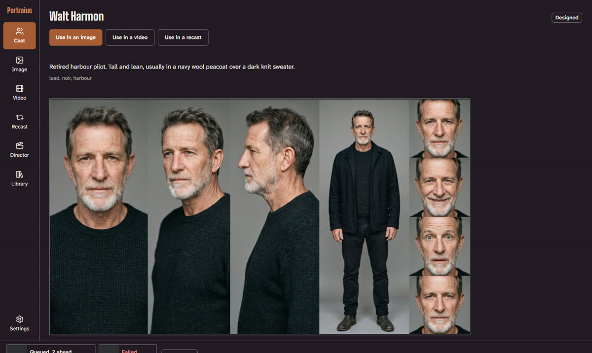
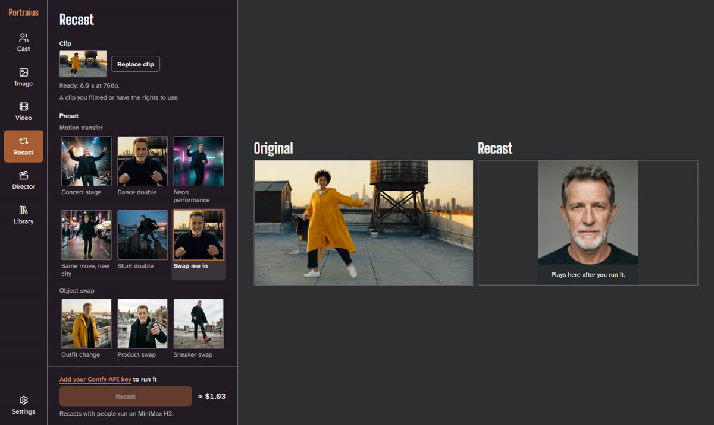
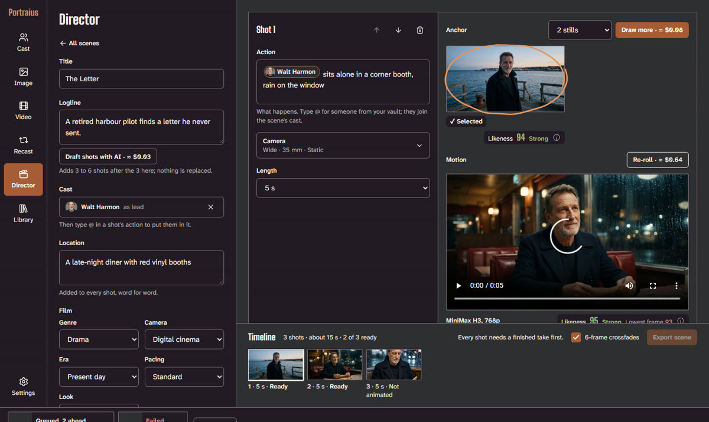
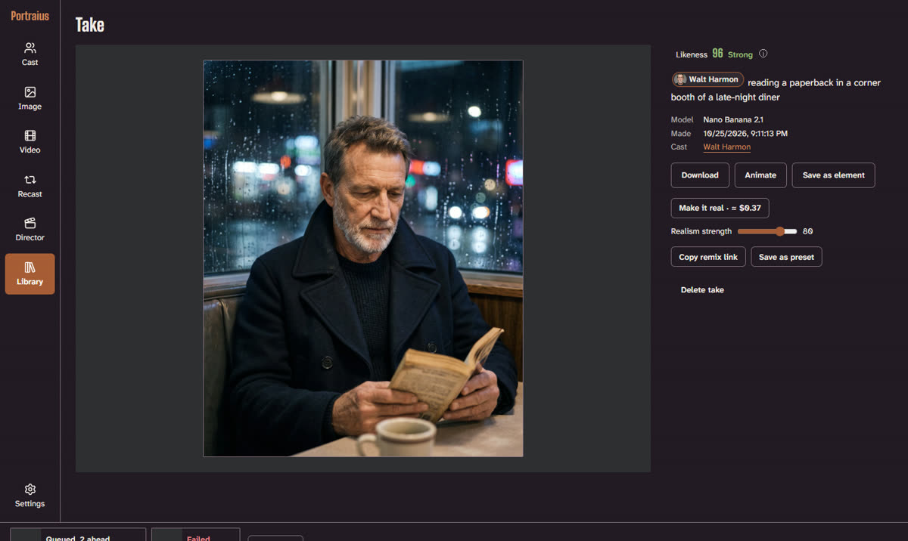
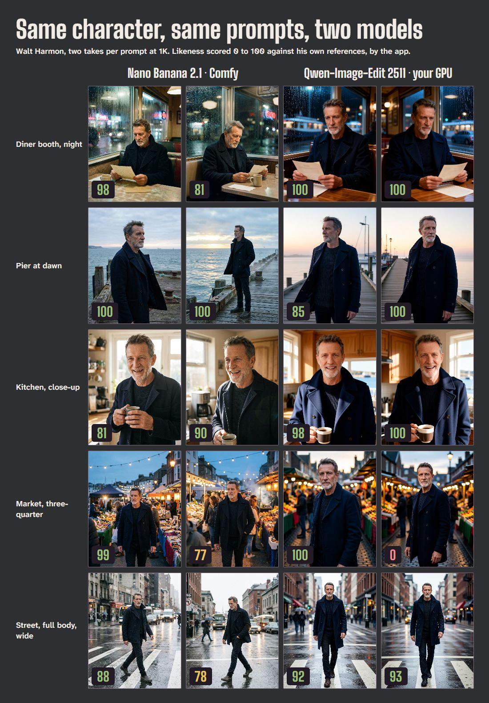

# Portraius Studio

Make a character once, from your own photos or a description, then put them in images, videos, recasts
and scenes that still look like them, with a number that says how much.


Portraius Studio is an open-source studio that runs in your browser on the
[Comfy Developer Platform](https://docs.comfy.org): on Comfy's models with your own Comfy key, on open-weight
models on your own GPU through ComfyUI for free, or both. Your characters and outputs stay in your browser. Built
for Comfy's Open Source Higgsfield competition (#OpenSourceHiggsfield).

## Start here

Open **[marzuwqlion.github.io/portraius-studio](https://marzuwqlion.github.io/portraius-studio/)** and pick one:

| You have | Do this | Time |
| --- | --- | --- |
| Nothing | Open the [Tour](https://marzuwqlion.github.io/portraius-studio/#/tour): pre-made samples of every feature with Walt Harmon, a designed character. Nothing runs, nothing to set up. | 1 minute |
| A Comfy API key | Paste it in **Settings**, then **Try this with Walt** in the Tour for a first image with a character already made. | 3 minutes |
| An NVIDIA GPU (24 GB is best) | Install ComfyUI and the model files ([`docs/local-setup.md`](docs/local-setup.md)), start it with the CORS flag (or a ready-made launcher from [`launchers/`](launchers)), tick **Use my ComfyUI** in Settings. Everything is free after that. | about an hour, mostly downloading |

To run the code yourself instead, see [Quick start](#quick-start).

**Contents:** [Why it's different](#why-its-different) · [Quick start](#quick-start) ·
[Using Portraius Studio](#using-portraius-studio) · [FAQ](#faq) · [Which model keeps a face?](#which-model-keeps-a-face) · [Models](#models) · [Costs](#costs) ·
[How it works](#how-it-works) · [ComfyUI workflows](#comfyui-workflows) · [Responsible use](#responsible-use) ·
[Contributing presets](#contributing-presets) · [License](#license)

## Why it's different

- **A character is a file you own.** A `.portraius` file is a zip of the photos, a turnaround sheet with four
  views, face data and the consent record. Export it, back it up, send it to someone you're making things with,
  import it on another machine, or open it in ComfyUI with the node pack. Elements (outfits, props, locations)
  use the same format.
- **Consent is built in.** A character from photos needs a short webcam check (three random prompts, a head-turn
  check and a face match against the photos) and the subject's typed name and 18+ statement. An import without a
  consent record stays locked: viewable, never usable.
- **An identity score on everything.** Each output with a cast member is scored 0 to 100 against that character's
  own references, in the browser with face-api (calibrated on 20 same-person and 20 different-person pairs). An
  image that drifts under 60 gets one automatic retry; videos are scored one frame a second.
- **Recast and Director, open.** Recast (the Genjutsu rebuild) keeps a clip's motion and camera and swaps in a
  character from your vault, swaps one object, or restyles it, with original and result side by side. Director
  (the Cinema Studio rebuild) plans a scene as shots with camera and lens controls, an anchor still per shot,
  a clip per shot, and one stitched MP4. A shot can pick up from the last frame of the one before; Kling can shoot
  the whole scene as one quick take; Claude can draft the shot list from a logline.
- **Presets anyone can add.** Camera moves, looks, image, video and Recast presets are JSON files in `presets/`,
  checked on every pull request. Any result can be shared as a remix link that carries the recipe, never a face.
- **Voices and lip sync.** Give a character one of 12 stock voices, write a line, and either lip-sync an existing
  clip to it (Sync-3) or have MiniMax H3 draw a new clip of the character saying it. Director shots can speak too.
  Stock voices only: no voice cloning.
- **Finishing.** "Make it real" adds skin texture to a still and scores it again, with a before/after wipe.
  "Export 9:16" puts a clip, or a Recast's original and result, in one vertical frame with an optional end card.
  Every file you download is tagged as AI-generated (see Responsible use).

## Quick start

Node 22 or newer.

```sh
npm ci
npm run dev
```

Open the local URL it prints, go to **Settings** and paste a Comfy API key with Router access
([platform.comfy.org](https://platform.comfy.org)). The key is kept in `sessionStorage`, or in IndexedDB if you
tick "Remember on this device". There's no `.env` key and no server to hold one.

| Command | Does |
| --- | --- |
| `npm test` | Unit tests (Vitest) |
| `npm run typecheck` | TypeScript across the app, scripts and Worker |
| `npm run smoke` | One image, one video draft, an estimate and a resumed job against real Router calls, with `COMFY_API_KEY` from your shell (costs cents) |
| `npm run presets:check` | Validates `presets/` |
| `npm run workflows` / `workflows:check` | Rebuilds `workflows/` from the app's prompts / checks them against ComfyUI's node definitions |
| `npm run nodepack` | Rebuilds the ComfyUI node pack's presets, prompt cases and example workflow from the app |
| `npm run voices:check` | Speaks one line in every voice in `presets/voices.json` through Router (costs cents) |
| `npm run build` | The static site in `dist/`, as GitHub Pages serves it |
| `npm run local:models -- <ComfyUI folder>` | Downloads the open-weight model files into a ComfyUI ([`docs/local-setup.md`](docs/local-setup.md)) |
| `npm run local:check` / `local:smoke` | Checks every local graph against your ComfyUI's nodes / runs each local model once on your GPU |

## Using Portraius Studio

Everything happens in one browser tab. Your characters, results and settings live in that browser's storage
(IndexedDB), so use the same browser each time, and export what you want to keep.

### 1. Set up where things run

Open **Settings** (bottom of the left rail).

- **Comfy API key.** Paste a key with Router access from [platform.comfy.org](https://platform.comfy.org) and
  press **Save key**. It's kept for this tab only, unless you tick **Remember on this device**. It's sent only to
  `api.comfy.org` and to the project's upload Worker, which checks it with Comfy and never stores it.
- **Your ComfyUI** (optional, free). Start ComfyUI with `--enable-cors-header` and this page's address (Windows
  portable and Linux or Mac have ready-made launchers in [`launchers/`](launchers)), tick **Use my ComfyUI**, and
  check the address (`http://127.0.0.1:8188` by default, `:8000` for ComfyUI Desktop). The card shows your GPU and
  marks each local model ready or lists the files it's missing, with download links. The app notices on its own
  when ComfyUI starts, stops or comes back; **Check again** asks at once. Setup steps are in
  [`docs/local-setup.md`](docs/local-setup.md).
- **Where things run.** With both a key and a ComfyUI, each feature (Character sheets, Image, Video, Recast,
  Make it real, Add a line, Director agent) has a default model; **Automatic** picks the Comfy model with a key and
  the local one without. **Never spend credits** hides every Comfy model, even with a key saved.
- **Generation.** Retry an image once, automatically, when its likeness drops under 60; keep a video's 480p draft
  after its final renders.
- **Your data.** How much this browser holds, and **Delete all data**.

Every Generate button shows its price first: dollars for Comfy models, "Free · your GPU" for local ones.

### 2. Make a character

Open **Cast** and choose how to make one:

- **From your photos.** Add 3 to 10 clear photos of one person (you, or someone making their own character with
  you). A short webcam check follows: three random prompts, a head turn and a face match against the photos,
  then the person's typed name and an 18+ statement. Without it, a character can't be used in anything.
- **Design from a description.** Describe an original person who isn't real (age, build, hair, skin, style).
  Pick one of four faces, then the app draws the turnaround sheet.
- **An element.** An outfit, prop or location from 1 to 6 photos, saved like a character and usable in any shot.

The **turnaround sheet** is one composite (front, three-quarter, profile, full body, four expressions) plus four
single views. Each view gets a likeness score; **Redraw** any one you don't like. Then add a **name**, a
**description** (what a face doesn't show: build, style, a usual outfit; it goes into every prompt with this
character), optional **tags** and an optional **stock voice**, and save.



A character's page has **Use in an image / a video / a recast**, its views, its voice, a **likeness sheet** (their
best-scored shots in one picture, each with its score, to download or share), **Export file** (a `.portraius`
file with the photos, sheet, face data and consent record) and **Delete character**. To bring a
character in, use **Import a .portraius file** on the Cast page; one without a consent record can be viewed but
not used.

### 3. Images

Open **Image**.

1. Pick a **preset** (it fills the scene and camera; your cast stays yours) or write your own **prompt**.
2. Add **cast**: choose characters in **Cast**, or type `@` in the prompt to put someone from your vault in the
   shot.
3. Optional **source image**: upload one, or use **Edit again** on a take, and the prompt describes the change.
4. Choose **aspect ratio**, **count** (1 to 4), **size** (1K, 2K, 4K), **quality** (Fast or Best) and, under
   **Camera and look**, shot size, angle, lens, aperture, lighting and look.
5. Press **Generate**. Takes appear on the right as they finish, each with its likeness score.

Pick a take to **Edit again**, **Animate** it into a video, **Save as element**, or **Make it real** (a realism
pass that adds skin texture, shown as a before/after wipe and scored again).

### 4. Video

Open **Video** and choose a mode:

- **Text**: a clip from a prompt alone.
- **Image, then animate**: draws an opening still with your cast first, then animates it. Best for people.
- **Use references**: the cast's sheets set who is in the shot (Comfy models only).
- **Animate an image**: upload a first frame.

Set the **model**, **duration**, **aspect ratio**, **seed** and **camera and look**. Without people, Seedance makes
a cheap 480p **draft**; press **Render final** for 1080p once you like it. Videos with a person go to MiniMax H3.
On your GPU, Wan 2.2 5B (fast) drafts and Wan 2.2 14B renders the final (720p, redrawn with the same seed, so it
can differ). Each clip offers **Continue from last frame** (the next clip starts where this one ends) and
**Speak a line**.

### 5. Speak a line

On a clip (in Video or in the Library), open **Speak a line**: write the line (up to about 40 words) and pick a
stock voice, or bring your own recording (MP3 or WAV, up to 15 s; on your GPU this is the only way, since ComfyUI
has no text-to-speech). Hear it, then either **lip-sync this clip** to it or make a **new speaking clip** of the
same cast. Stock voices only: no voice cloning.

### 6. Recast

Open **Recast**.

1. **Clip**: drop a clip, **Upload a clip**, pick one from the library, or **Try the sample**. **Trim** it to the
   length the mode allows (shown under the button).
2. **Preset**, in four groups: **Motion transfer** (a character from your vault performs the clip's moves, timing
   and camera; some presets also move them to a new setting), **Object swap** (replace one thing, from an image
   you upload), **Setting** (replace the surroundings) and **Style swap** (claymation, 1970s film and more).
3. **Performer** (or the replacement image), and optional **direction** words.
4. Tick that you filmed the clip or have the rights to use it (the sample needs no check), then **Recast**.



The result plays original and recast side by side; drag the line to compare. **Re-roll** appears when likeness
drifts, and **Export 9:16** puts both in one vertical frame. On your GPU, Recast does motion transfer in two
steps: Qwen draws the performer into the clip's first frame and setting, then Wan Animate 2 moves them through the
clip with its sound (about 15 minutes for 8 seconds on an RTX 4090).

### 7. Director

Open **Director** and start from the sample scene or **New scene**.

1. **Title**, **logline**, **cast** and **location** (added to every shot word for word), plus the **film**:
   genre, camera, era and pacing.
2. **Draft shots with AI** plans 3 to 6 shots from the logline (Claude with a key, Gemma 4 on your GPU); or
   **Add shot** and write each one.
3. For each shot: the **action** (type `@` for a cast member), the **camera** (size, angle, lens, movement,
   lighting), the **length**, and whether it **starts with** a cut or the previous shot's last frame. If the video
   model can't make that length, the field says what the take will run.
4. **Draw stills**, pick an **anchor**, then **Animate**. **Re-roll** a take, **Render final**, or give the shot a
   line.
5. When every shot has a finished take, **Export scene** joins them into one MP4, with 6-frame crossfades if
   ticked. **Shoot as one take** (Kling, with a key) makes the whole scene as one quick clip.



### 8. Library, sharing and the Tour



- **Library** holds every result, filterable by type, cast member, model, likeness band and date. A result's page
  has **Download**, **Export 9:16** (with an optional end card that can carry the likeness score, and **Share** on
  phones), **Speak a line**, **Animate**, **Make it real**,
  **Copy remix link**, **Save as preset** and **Delete**. **Select to export** saves several results as one zip.
- A **remix link** carries a result's recipe, never a face: whoever opens it picks their own characters for each
  slot and runs it with one click.
- The **activity bar** at the bottom shows what's working and what failed, with **Cancel** and **Retry**; today's
  finished results fold into **N done**. Jobs pick up where they stopped after a reload.
- The **Tour** plays pre-made samples of every feature with Walt Harmon, and **Try this with Walt** opens the same
  thing with him cast.

### Likeness scores

Each output with a cast member gets a score from 0 to 100 against that character's own references: **80 and up**
is a strong match, **60 to 79** is worth a look, and **under 60** has drifted (an image gets one automatic retry).
Videos are scored a frame a second, with the lowest frame shown too; frames where the face is too small (under 80
px) or turned away are skipped. In an image, a cast member whose face isn't found scores 0. Stylised looks (anime,
claymation) show "Score not available". The score measures likeness, not identity.

### Which model keeps a face?

We ran the same character and prompts through Comfy's models and the open-weight ones on an RTX 4090 and read
off the app's own scores ([full report](docs/likeness-report.md)):

| Task | Comfy | Your GPU |
| --- | --- | --- |
| Stills, 10 each | Nano Banana 2.1: median 89, all 77 or more | Qwen-Image-Edit 2511: median 99, nine of ten 85 or more |
| 5 s video, 2 each | MiniMax H3: 83 and 100 | Wan 2.2 14B: 82 and 85 |
| Recast of a dance | MiniMax H3: 59 | Wan Animate 2: 63 |

One character and a few runs, so a first look rather than a benchmark: both paths keep the face, H3 holds it best
through movement, and the free local path is competitive.



### When something goes wrong

A failed job says why, in plain words, with **Retry** when a retry can help. The usual ones: a missing or invalid
key (Settings), not enough credits, a provider refusing an input (change it and retry), and, on your GPU,
"Couldn't reach your ComfyUI" (start it with the CORS flag), "missing {file}" (Settings lists the link), "ran out
of memory" (shorter clip, smaller size or the faster model) and "restarted before this finished" (retry it).

## FAQ

- **Do I have to pay?** No. The Tour is free, and on your own GPU everything is free. With a Comfy key you pay
  Comfy per generation, and every Generate button shows the price before it runs.
- **Do I need a GPU?** No. With a Comfy key everything runs on Comfy's models. A GPU lets you run open-weight
  models for free instead, or as well.
- **Where do my photos and characters go?** They stay in your browser. A generation sends Comfy only what it
  needs (a prompt and reference images); on your GPU nothing leaves your computer. Export a character as a
  `.portraius` file to keep it or move it to another browser.
- **Can I make a character of someone else?** Not from their photos: a character from photos needs a webcam check
  of that person. They make their own and send you the file. Designed characters (from a description) are
  original people who don't exist.
- **Is it safe to let the site use my ComfyUI?** Mostly, with a few habits; see
  [Is it safe?](docs/local-setup.md#is-it-safe) in the setup guide.
- **Which browsers?** Chrome, Edge and Firefox on Windows were tested with a local ComfyUI. Safari hasn't been
  tried.
- **What does the likeness number mean?** See [Likeness scores](#likeness-scores).

## Models

Every call goes through [Comfy Router](https://docs.comfy.org/development/comfy-router/queue.md), queued so it
survives a reload; only ElevenLabs runs on Router's synchronous route, because it answers with the audio itself.
Model IDs live in one file, `src/lib/registry/models.ts`. No request sends `model_provider` (and the synchronous
call sends `fallback_provider=false`), so each model is served by its own provider.

| Model | Router ID | What it does here |
| --- | --- | --- |
| Nano Banana 2.1 | `vertexai/gemini-nano-banana-2.1` | Character sheets and views, designed faces, element sheets, every image, the opening frame in Image, then animate, Director's anchors |
| Seedance 2.5 | `byteplus/dreamina-seedance-2-5-260628` | Video without people: a 480p draft, then a 1080p final from the draft's ID |
| MiniMax H3 | `minimax/minimax-h3` | Every video with a person in it, and Recast's Motion transfer. Seedance refuses photoreal people as input images |
| HappyHorse 1.0 video edit | `wan/happyhorse-1.0-video-edit` | Recast's Object swap and Setting changes, keeping the clip's timing |
| Freepik skin enhancer | `freepik/ai-skin-enhancer-faithful` | Make it real |
| Kling V3 Omni | `kling/kling-v3-omni` | Director's one-take: every shot of a scene in one clip, each with its own prompt |
| ElevenLabs v4 | `elevenlabs/eleven_v4` | A character's lines, in 12 checked stock voices |
| Sync-3 | `synclabs/sync-3` | Lip sync: moves the mouth of a finished clip to a line |
| Claude Sonnet 5.5 | `anthropic/claude-sonnet-5-5` | Director's "Draft shots with AI" |
| Wan 2.7, BFL video edit | `wan/wan2.7-videoedit`, `bfl/video-edit-v1` | Object swap alternatives, compared with Kling in [`docs/notes/recast-ab.md`](docs/notes/recast-ab.md) |

### Built with MiniMax H3

MiniMax H3 is the core video model wherever a person is on screen. Seedance refuses photoreal people as input,
so every clip of a character from your vault runs on H3:

- **Image, then animate** and **Use references** in Video: the character's still or sheet becomes an H3 clip,
  with the person's identity scored frame by frame.
- **Recast's Motion transfer**: a character from your vault takes over a clip's moves, timing and camera on H3
  reference mode, with the clip's own sound kept.
- **Speak a line**: a new clip of the character saying the line, with H3's native audio.
- **Director**: every shot with a cast member is an H3 take, and shots can continue from the last frame of the
  one before.

The same H3 graphs ship as ComfyUI workflows: `still-first-video`, `recast` and `add-a-line` in
[`workflows/`](workflows/README.md).

### On your own GPU, free

Portraius Studio can also run on a ComfyUI you start yourself, with open-weight models under Apache 2.0, all
native ComfyUI nodes: Qwen-Image-Edit 2511 for characters and images, Wan 2.2 (14B, and 5B for fast drafts) for
video, Wan Animate 2 (on a Qwen still of the performer in the setting) for Recast's motion transfer, Wan 2.2 S2V for speaking clips, SeedVR2 for Make it real and
Gemma 4 for the Director's shot plans. Turn it on in Settings, with or without a key; each picker then lists what runs
on your GPU and what runs on Comfy credits. [`docs/local-setup.md`](docs/local-setup.md) covers the ComfyUI flags
and the model files (`npm run local:models` downloads them).

## Costs

Every Generate button shows the price before it runs: Router's own figure when `/estimate` is enabled for your key,
otherwise "≈ $0.08" from a table of Comfy's published rates (each row cited in
[`docs/notes/u1-notes.md`](docs/notes/u1-notes.md)). A model with no published rate shows no price. Video without people starts as a cheap 480p Seedance draft; you pay for
the 1080p final only when you like the draft, and the final reuses the draft's ID instead of sending everything
again. Results download into your browser as soon as they finish, so Router's links expiring never costs a re-run.

## How it works

```
Browser (GitHub Pages)                          Comfy Router          Provider
Studio UI -> Router client -------------------> queue --------------> Google, BytePlus,
(prompt,     (model allowlist, your key)        (request ID)          MiniMax, Alibaba, Freepik
 image prep)
Library   <- download (bytes in IndexedDB) <---- result <-------------+
 + identity score (face-api, in the browser)
```

The request runs left to right; the result comes back right to left, its bytes saved before the link expires,
then scored in the browser. A small Cloudflare Worker ([`proxy/`](proxy/README.md)) does the two things a browser
can't: it hosts short-lived copies of clips and lines that providers fetch by URL (deleted when the job ends, and
by R2 after a day), and streams back results from hosts a browser can't download from (Comfy's Seedance bucket,
Sync Labs). It forwards requests and stores no keys.

| Folder | Holds |
| --- | --- |
| `src/lib/router` | The only code that talks to Comfy: Router client, error mapping, downloads |
| `src/lib/jobs` | The job state machine and runner: queue, poll, download, score, resume after a reload |
| `src/lib/adapters`, `src/lib/registry` | One adapter per model (app input to native body, native result to assets), the model list, and types generated from Router's schemas |
| `src/lib/characters` | The create wizard's logic, consent check, sheets, elements, `.portraius` import and export |
| `src/lib/identity` | face-api detection, the distance-to-score mapping, face-to-cast assignment |
| `src/lib/studio` | Image, Video, Recast, Director, realism and 9:16 export logic |
| `src/lib/media` | Image prep, ffmpeg.wasm trims and joins, the AI-generated tag |
| `src/routes`, `src/components` | Screens and components |
| `presets/` | Camera, look, image, video and Recast presets |
| `public/samples/` | Tour mode's samples |
| `workflows/` | The ComfyUI workflows |
| `custom_nodes/comfyui-portraius-characters/` | The ComfyUI node pack |
| `proxy/` | The Cloudflare Worker |
| `docs/` | The build spec ([`docs/SPEC.md`](docs/SPEC.md)) and per-milestone notes |

## ComfyUI workflows

[`workflows/`](workflows/README.md) has every studio feature with a ComfyUI partner node as a graph, in UI and
Workflow (API) format:

- **Characters:** your photos to a turnaround sheet and four views (character-sheet), a person designed from text
  (design-from-text), and outfits, props and locations (element-sheet), all with Nano Banana 2.1.
- **Images:** a still with a cast, and editing a source image (image-studio); the realism pass with Magnific's skin
  enhancer (make-it-real).
- **Video:** "Image, then animate" with the character on MiniMax H3 and a shot without people as a Seedance 2.5
  draft, then its final (still-first-video); text to video, use references and animate an image (video-studio).
- **Recast:** motion transfer with a new setting and the clip's own audio, a style swap and an object swap, on
  MiniMax H3 and HappyHorse (recast).
- **Finishing:** a line in an ElevenLabs voice, lip-synced with Sync-3 or spoken in a new H3 clip (add-a-line).
- **Director:** the sample scene shot by shot and joined (director-scene), as a Kling 3.0 Omni one-take
  (kling-one-take), and its shot list drafted by Claude Sonnet 5.5 (draft-shots).

They're generated from the app's own prompt code and presets, so a graph sends what the app sends, and checked
against ComfyUI's published node definitions. The workflows README lists where a graph has to differ from the app.

The node pack in [`custom_nodes/comfyui-portraius-characters/`](custom_nodes/comfyui-portraius-characters/README.md)
brings the character file itself into ComfyUI: **Load Portraius Character** (a person from photos needs their
consent record, as in the app), **Character Prompt** (a Python port of the app's prompt compiler, tested word for
word against it, with the reference images it names) and **Identity Score** (0 to 100 on the app's scale, from
FaceNet). Copy the folder into `ComfyUI/custom_nodes/`; an example workflow comes with it.

## Responsible use

- **Consent.** The consent record is an attestation, not proof: the person on camera says they're the person in
  the photos and 18 or older, after a liveness and face-match check. Characters of other real people come from
  those people: they make their own character and send you the file.
- **No impersonation.** Don't use Portraius Studio to impersonate anyone or to make anything they wouldn't agree
  to. Recast only takes faces from your vault, never from a random photo, and every clip needs you to confirm you
  filmed it or have the rights to it.
- **No unlicensed IP.** Elements warn against logos and trademarked designs, and preset checks reject brand and
  celebrity names. Provider safety filters stay at their defaults.
- **Disclosure.** Downloaded images carry an XMP note (the IPTC "trained algorithmic media" source type and
  "AI-generated with Portraius Studio"), and videos an MP4 comment. Files that already carry the provider's signed
  C2PA Content Credentials (Nano Banana, Seedance, BFL) are left as they are, since those already say
  AI-generated and an added byte would break the signature.
- **Biometric data.** Face descriptors and consent clips stay in your browser and leave it only inside a
  `.portraius` file you export. Settings has "Delete all data".
- **The score measures likeness**, not who someone is. Faces generated from the same description can look alike
  to it.
- To report misuse, open an issue on this repository.

## Contributing presets

Copy `presets/_template.json` into `presets/image/`, `presets/video/` or `presets/recast/`, fill it in, run
`npm run presets:check`, and open a pull request. The same check runs on every pull request. Thumbnails use
designed characters, never photos of real people; `npm run thumbnails` makes the built-in ones with Walt Harmon. See [`CONTRIBUTING.md`](CONTRIBUTING.md).

## License

MIT, see [`LICENSE`](LICENSE). The models are not covered by it: each provider's outputs and use are subject to
its own terms, through your Comfy account.

Bundled third-party files: face-api weights (`public/models/`, MIT) and the ffmpeg.wasm core (`public/ffmpeg/`,
GPL-2.0-or-later, loaded as a separate program in a web worker; source at
[github.com/ffmpegwasm/ffmpeg.wasm](https://github.com/ffmpegwasm/ffmpeg.wasm)). Fonts: Big Shoulders Display and
Atkinson Hyperlegible Next (SIL Open Font License).
