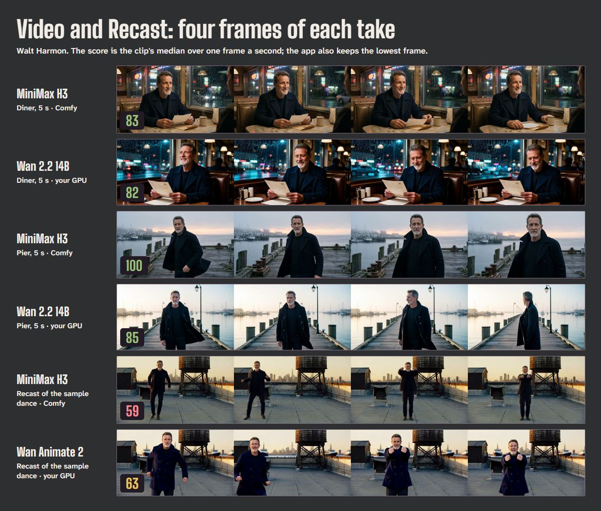

# Which model keeps a face? A likeness report

October 25, 2026. The same character, the same prompts and the same settings, run through Comfy's models and the
open-weight models on an RTX 4090, each output scored by the app's own likeness check: 0 to 100 against the
character's own references, in the browser with face-api (spec: Identity match score). Every result here was made
in the app, not with a separate script.

## Results

| Task | Model | Where | Runs | Likeness (each run) | Median | Lowest frame |
| --- | --- | --- | --- | --- | --- | --- |
| Still, 1K | Nano Banana 2.1 | Comfy | 10 | 98, 81, 100, 100, 81, 90, 99, 77, 88, 78 | 89 | |
| Still, 1K | Qwen-Image-Edit 2511 | your GPU | 10 | 100, 100, 85, 100, 98, 100, 100, 0\*, 92, 93 | 99 | |
| Video, 5 s, from a still | MiniMax H3, 768P | Comfy | 2 | 83, 100 | 92 | 72, 96 |
| Video, 5 s, from a still | Wan 2.2 14B, 720p | your GPU | 2 | 82, 85 | 84 | 80, 29 |
| Recast of the sample dance | MiniMax H3 | Comfy | 1 | 59 | 59 | 47 |
| Recast of the sample dance | Qwen still, then Wan Animate 2 | your GPU | 1 | 63 | 63 | 53 |

\* Qwen's market take has Walt's face plainly in frame but small in a wide 1K shot. The face detector skips faces
under 80 px, and an image whose cast member isn't found scores 0, so this is a limit of the measurement, not a
different face.

## What it shows

- **Stills: both keep the face; Qwen sticks closer to the reference.** Every Nano Banana still scored 77 or
  more; nine of ten Qwen stills scored 85 or more. Qwen repeats the reference sheet's coat, build and framing,
  which helps the score; Nano Banana varies the pose and composition more, and a turned or smiling face costs it
  a few points.
- **Video: H3 holds the face through a move.** On the pier, H3 stayed at 96 or better in every scored frame as
  Walt turned to camera; Wan 14B's median was 85 but one frame, his head turned away, fell to 29. In the diner both
  stayed in the 70s and 80s.
- **Recast: both drift with a dancer's moves.** A full-body dance at a distance, with big expressions, keeps
  faces small and moving; both recasts landed near 60, in the Review band, and both read as Walt to the eye. The
  Tour's pre-made H3 recast of the same clip scored 90, so a single run says little: re-roll a drifted recast.
- **Local is competitive.** On this character, the free open-weight path matched or beat the paid models on
  stills and came close on video.

## How it was run

- **Character:** Walt Harmon, the Tour's designed character (his sheet was drawn by Nano Banana 2.1).
- **Stills:** five prompts (a diner booth at night, a pier at dawn, a kitchen close-up, a market in three-quarter
  view, a street crossing full body), two takes each per model, 4:5 at 1K Fast, through the Image studio's own
  request code with a new seed per take. Nano Banana gets Walt's sheet and front view; Qwen, which takes at most
  three images, gets his front view.
- **Video:** "Image, then animate" with Walt, 5 s: H3 from a Nano Banana still, Wan 2.2 14B from a Qwen still.
- **Recast:** the Tour's dance clip with "Swap me in" and Walt as the performer: H3 reference mode, and the local
  two steps (a Qwen still in the clip's first frame, then Wan Animate 2).
- **Scoring:** images score every detected face; videos score one frame a second, report the median and keep the
  lowest frame. Faces under 80 px are skipped (in an image, a skipped cast member scores 0).
- **Cost:** about $2.96 of Comfy credits (Nano Banana stills about $0.05 each, a 5 s H3 clip about $0.64, the H3
  recast $1.03); the local runs cost nothing.

## Limits

One character, a few runs per task and random seeds: treat this as a first look, not a benchmark. The score
measures likeness to the character's references, not image quality or prompt following, and faces from the same
description can look alike to it. Results will differ for characters made from photos. Anyone can run the same
comparison in the app: the same prompts with a different model selected, read off the likeness badges.
